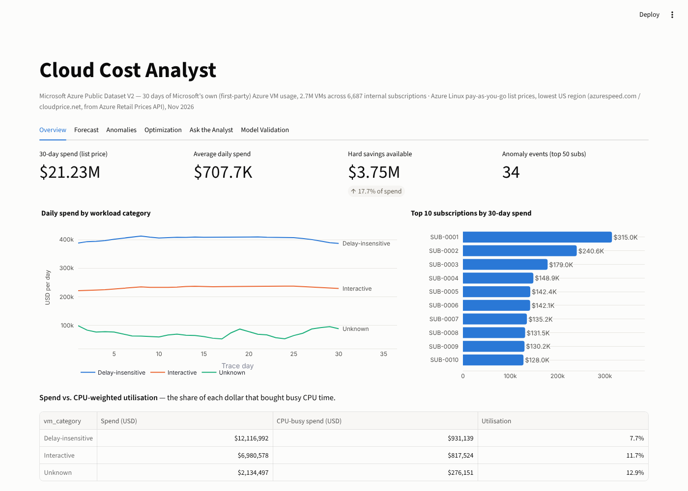
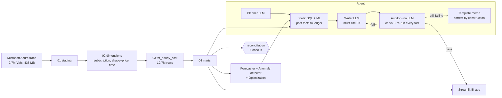
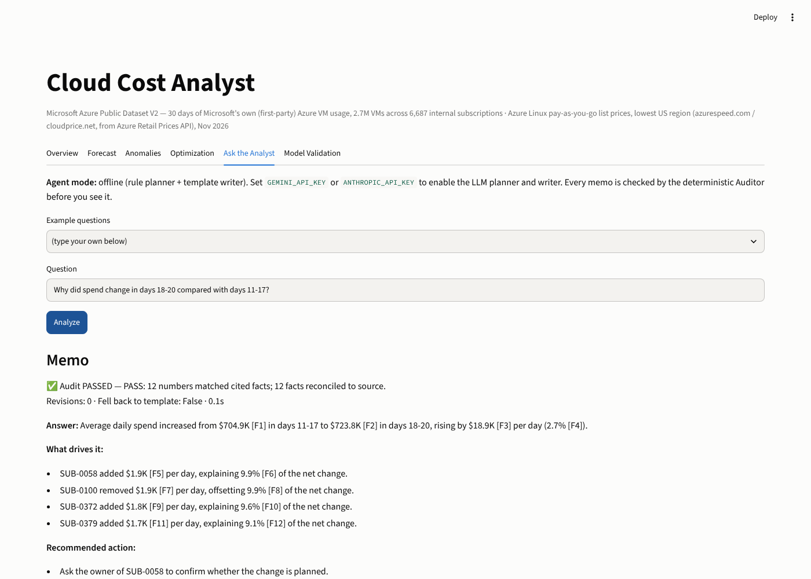
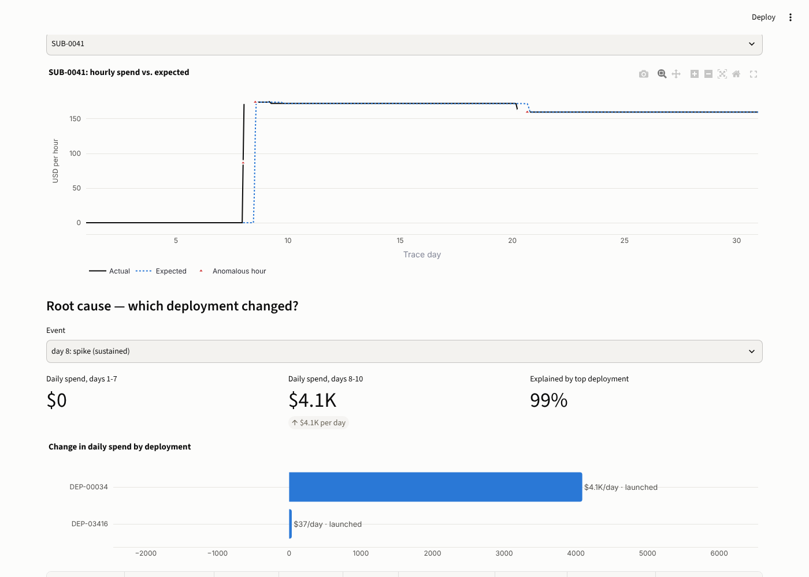
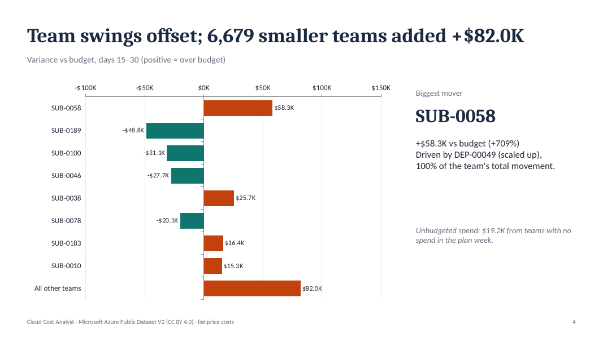
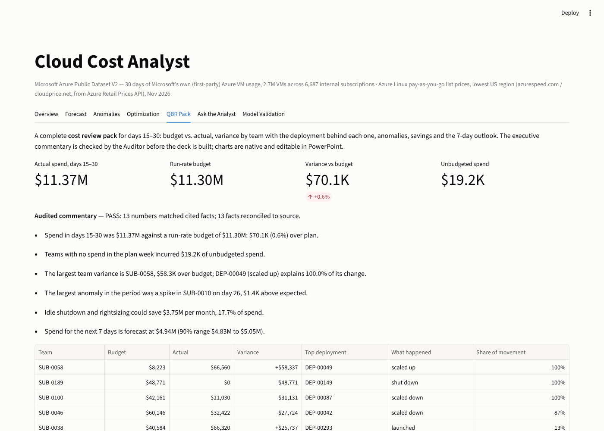

# Cloud Cost Analyst — a self-checking AI analyst for cloud spend

[](https://github.com/bshrey0601/Cloud-Cost-Analysis/actions/workflows/tests.yml)


An end-to-end FinOps BI application built on **Microsoft's official Azure Public Dataset**:
30 days of Microsoft's *own* internal (first-party) Azure VM usage — 2,695,548 VMs across
6,687 internal subscriptions — priced at Azure's published list prices.

It answers the questions a Product Finance team asks about engineering cloud spend
(*why did spend move? what will it be next week? what's anomalous? where can we save?*)
with an **AI agent whose every number is independently verified before anyone sees it**.

| | |
|---|---|
| **Data** | Microsoft Azure Public Dataset V2 (2019 VM trace) — 438 MB raw, 12.7M-row hourly cost fact table |
| **SQL** | DuckDB star schema (Snowflake-portable), 8 automated reconciliation checks — all tie out to the cent |
| **ML** | From-scratch NumPy forecaster + anomaly detector, validated against standard baselines on held-out data |
| **AI** | Planner → Analyst (tools) → Writer → **Auditor** agent loop; Gemini or Claude, with an offline mode |
| **Root cause** | Every team-level cost change decomposed exactly by deployment: launched, shut down, scaled, migrated |
| **QBR pack** | One click → a 9-slide, editable PowerPoint cost review with audited commentary |
| **BI** | Streamlit app: Overview · Forecast · Anomalies (with root cause) · Optimization · QBR Pack · Ask the Analyst · Model Validation |



---

## Headline results

| What | Result |
|---|---|
| Monthly spend analysed (list price) | **$21.23M** (≈ $708K/day) |
| Hard savings found (idle + rightsizing, no assumed discounts) | **$3.75M / month — 17.7% of spend** |
| Next-day forecast error on total spend (daily-total MAPE, 15 rolling folds) | **0.86%** vs 1.04% Holt-Winters |
| Next-week forecast error on total spend | **0.91%** vs 2.06% Holt-Winters (56% lower) — *see the untouched-series check: this does not generalize to team-level series* |
| Next-day error on 50 team series **never used in development** (dollar-weighted) | **1.31%** vs 1.62% Holt-Winters (19% lower) |
| 90% forecast intervals — actual coverage on held-out hours | **90.3%** (well calibrated) |
| Anomaly detector on held-out subscriptions (252 injected events) | **F1 0.946**, precision 0.983, **17.6× fewer false alarms** than a rolling z-score |
| Auditor: corrupted memos caught (531 faults, 9 fault types) | **99.8%**, with **0%** false positives on clean memos |
| Agent vs. independently computed ground truth (30 questions) | **30/30** correct, 100% audit pass (offline mode) |
| Root cause: anomalies where one deployment explains most of the change | **56%** of 34 real anomalies; decomposition exact to < $10⁻¹² |
| QBR pack: commentary figures verified before the deck is built | **13/13** numbers matched, 13 facts re-run from source |

---

## Why this project (mapping to the role)

| The job asks for | Where it is in this repo |
|---|---|
| SQL — analyze data, standardize queries, build large-scale relational datasets | `sql/` star schema: staging → dimensions → 12.7M-row hourly fact → reporting marts, with reconciliation |
| Python & application development (scalability, UX) | `src/cca/` package, vectorized models, `app/` Streamlit app, 20 pytest tests |
| Enterprise BI tools (Streamlit, Tableau, Looker) | `app/streamlit_app.py` — six-tab BI app; Snowflake publishing in `snowflake/` |
| ML models to identify cost anomalies & forecast cloud spend | `forecasting.py`, `anomaly.py` + `eval/run_model_validation.py` |
| Recommend optimization strategies | `optimization.py` — idle, rightsizing, commitment, Spot levers |
| Agentic frameworks that gather data, run multi-step analyses, produce executive-ready insights | `agent.py`, `tools.py`, `auditor.py`, `prompts/` |
| AI and prompt development | `src/cca/prompts/*.md` — planner, writer, reviser prompts |
| Streamline QBR workflows / variance analysis | `qbr.py` + `qbr_pptx.py`: budget vs. actual, variance bridge and audited commentary as an editable PowerPoint |
| Surface actionable insights that optimize spending | `rootcause.py`: names the deployment behind every change, so each insight has an owner |

---

## The data (and why it fits Product Finance)

**Source:** Microsoft Azure Public Dataset V2 — https://github.com/Azure/AzurePublicDataset
(`AzurePublicDatasetV2.md`). Released by Microsoft Research with the paper
*Cortez et al., "Resource Central: Understanding and Predicting Workloads for Improved Resource
Management in Large Cloud Platforms", SOSP 2017.* Data licensed CC BY 4.0 (code MIT) by Microsoft — attribution above.

It is a representative sample of **first-party** Azure workload — Microsoft's own product teams
running on Azure — which is exactly the situation of a Product Finance team analysing
*internal engineering* cloud spend. Each "subscription" behaves like a cost centre.

Per VM: encrypted subscription/deployment IDs, create/delete timestamps, CPU utilisation
(avg, max, P95), vCPU and memory buckets, and Microsoft's workload label
(Interactive / Delay-insensitive / Unknown).

**Pricing** (`src/cca/pricing.py`): Azure Linux pay-as-you-go list prices, lowest US region, as
published in Nov 2026 (azurespeed.com and cloudprice.net, both sourced from Azure's Retail
Prices API) — e.g. D2s v5 $0.096/h, E2s v5 $0.126/h, F2s v2 $0.0846/h. Exact SKU prices are used
where a trace shape matches a real SKU; otherwise a linear model fitted exactly on D2s v5 + E2s v5
($0.033 per vCPU-hour + $0.00375 per GB-hour), which reproduces D8s v5 and E8s v5 exactly and
F2s v2 within 4.3%.

> Caveat: 2019 usage is priced at 2026 list rates. This is a realistic cost signal for building
> FinOps models, not Microsoft's actual internal cost.

---

## Architecture



### The self-checking agent

1. **Planner** (LLM, or a rule-based planner offline) chooses tools: `spend_summary`,
   `compare_periods`, `detect_anomalies`, `forecast_spend`, `optimization_opportunities`, and
   `compute` for any derived number.
2. **Analyst** executes the tools. Every number they produce is posted to a **fact ledger**
   (`F1, F2, ...`) with its provenance (tool, arguments, path in the output).
3. **Writer** (LLM) drafts an executive memo and must cite a fact for every number.
4. **Auditor** — deterministic, no LLM, so it cannot be talked out of a failure:
   - every dollar/percent/count/duration must carry a citation in the same sentence;
   - the number must be a correct *rounding* of a cited fact (tolerance = half a unit of the last digit shown);
   - direction words must agree with signs ("increased from A to B" requires B > A; "below expected" requires a negative deviation);
   - every cited fact is **re-run from the warehouse on a fresh read-only connection** and reconciled.
5. If the audit fails, the writer revises with the auditor's findings (max 2 rounds). If it still fails,
   the agent falls back to a template memo built directly from the ledger — **a failed audit never
   reaches a stakeholder.**

The design is the reconciliation discipline from financial data operations (validate every
transaction, flag exceptions, tie reports back to the source system) applied to AI output.



---

## Root-cause attribution: which deployment changed?

An alert or a variance is only actionable once it names **what changed and who owns it**.
Microsoft's trace groups VMs into 33,205 *deployments* (a service, a test environment, a batch
fleet). `rootcause.py` decomposes any team's change in daily spend **exactly** by deployment and
labels each driver:

| Label | Meaning |
|---|---|
| launched | no spend before, spend now — a new environment |
| shut down | spend before, none now |
| scaled up / scaled down | present in both windows, spend changed |
| possible migration | one deployment shrank while another of similar size grew (a flag for the owner to confirm) |

Example the agent produces, audited:

> SUB-0041's daily spend rose from $0.00 in days 1–7 to $4.1K in days 8–10. The top deployment,
> DEP-00034, accounts for 99.1% of the change: launched on day 8 with 1,934 VMs (2 vCPU / 2 GB,
> Interactive workload).

Across all **34 anomalies** the detector finds on the real data, a single deployment explains the
majority of the change in **56%** of them (15 launches, 10 scale-ups, 8 scale-downs, 1 shutdown),
and every decomposition sums back to the team's change to within $10⁻¹² per day
(`eval/run_root_cause_eval.py`). The Anomalies tab shows the drivers for any event, and the agent
automatically explains the largest anomaly it finds.



## QBR pack: the quarterly cost review, generated and audited

The **QBR Pack** tab (or `PYTHONPATH=src python -m cca.qbr_pptx --out review.pptx`) builds the
review a Product Finance analyst assembles by hand each cycle — a 9-slide, fully editable
PowerPoint with native charts and speaker notes:

1. Title · 2. Executive summary with audited commentary · 3. Budget vs. actual by workload ·
4. Variance by team · 5. Root cause for each variance · 6. Anomalies with named causes ·
7. Savings opportunities · 8. 7-day outlook with 90% interval · 9. Method and audit trail

- **Budget:** standard FP&A run-rate method — the plan is set on day 14 from the average daily
  spend of days 8–14; teams with no spend in the plan week are reported as *unbudgeted*.
- **Audit:** the executive commentary is built from ledger facts and must pass the Auditor
  (every number re-run from the warehouse) before the deck is generated; if it fails, no deck.
- **What it found on this data:** spend for days 15–30 was 0.6% over plan, but team swings
  largely offset; SUB-0058 ran $58.3K over budget entirely because DEP-00049 scaled up, while
  SUB-0189 shut down completely ($48.8K under).

A sample deck is in [`docs/sample/cloud_cost_review.pptx`](docs/sample/cloud_cost_review.pptx).





## Model validation (all numbers reproducible with `eval/`)

### Forecasting — rolling-origin backtest, origins on days 15–29

Error on the forecast-period total for **total spend** (lower is better):

| Model | Next day | Next week |
|---|---|---|
| **CloudSpendForecaster (ours)** — horizon-aware self-selecting blend | 0.86% | 0.91% |
| SeasonalRidge (ours, component) | **0.82%** | 1.45% |
| ProfileDampedTrend (ours, component) | 1.37% | 1.94% |
| Holt-Winters (statsmodels) | 1.04% | 2.06% |
| Seasonal naive — same hour last week | 1.01% | **0.64%** |
| Seasonal naive — same hour yesterday | 1.09% | 1.51% |
| Naive — last value | 1.27% | 2.14% |

Honest reading: the blend beats Holt-Winters at both horizons and is the most consistent model
across series (full table by category in `eval/results/forecast_summary.csv`). It is **not** the
best at every cell: a plain "same hour last week" wins the week-ahead total, because Microsoft's
spend has a weekly rhythm that only pays off at week-long horizons. With only 30 days of history
the blend has few validation folds to learn that; with a longer history it would weight that
component more.

### Untouched-series check (the honest test)

I designed the forecaster while watching backtests on the four series above, so those scores
can be optimistic. `eval/run_untouched_forecast_check.py` re-runs the **final, unchanged** model
on 50 series it never saw during development — the hourly spend of the 50 largest teams
(subscriptions) — with no re-tuning. Dollar-weighted error on the forecast-period total:

| Model | Next day | Next week |
|---|---|---|
| **CloudSpendForecaster (ours)** | **1.31%** | 2.76% |
| Holt-Winters (statsmodels) | 1.62% | 2.20% |
| Seasonal naive — same hour yesterday | 1.65% | **1.97%** |
| Seasonal naive — same hour last week | 3.43% | 2.28% |
| Naive — last value | 1.66% | 2.23% |

- **Next-day generalizes:** lowest dollar-weighted error, 19% below Holt-Winters. But for the
  *typical* (median) team, "last value" is best (27 of 50 series): steady teams barely move, and
  the model earns its edge on the large, volatile teams that dominate dollars.
- **Next-week does not generalize:** on team series the model is the worst of the five. Team spend
  moves in step changes (an environment is created or torn down), and the weekly and trend
  components carry an old level forward. The week-ahead win on total spend was partly fitted to
  the development series. I did not re-tune on these 50 series, because that would turn the only
  clean test set into another development set.
- **What ships:** the blend for day-ahead forecasts at any level and for week-ahead totals; for
  week-ahead forecasts of an individual team, the forecast tool routes to "same hour yesterday"
  (`choose_model` in `forecasting.py`). The attempt to fix the blend itself is below.

### Attempted fix: step-aware forecasting (tested, not shipped)

Team spend moves in steps, so I built a v2: a fourth "recent level" component, plus step detection
that switches to it when a team has just moved to a new stable level. Because the 50 team series
had now been looked at once, I split them: design choices on 25 teams, final score on the other
25, plus a regression check on the original four series. Dollar-weighted error on the period total:

| Model | Tuning teams, next week | **Test teams, next day** | **Test teams, next week** | Total spend, next week |
|---|---|---|---|---|
| v1 blend (shipped) | 1.10% | **1.53%** | 4.47% | 0.91% |
| v2 step-aware | **1.01%** | 1.78% | 3.55% | **0.90%** |
| Same hour yesterday | 1.75% | 1.80% | **2.19%** | 1.51% |
| Holt-Winters | 1.89% | 1.61% | 2.51% | 2.06% |

v2 cut v1's week-ahead team error by 21%, but on the held-out teams it still lost clearly to the
simple baseline and it made next-day team forecasts worse, so **it is not the default**. The two
halves of the teams disagree sharply (v1 beats every baseline on one half and loses on the other),
which says team-level week-ahead forecasting from 30 days of history is high-variance; the honest
product decision is the routing rule above, not more tuning against the test set
(`eval/run_team_forecast_experiment.py`).

Intervals are split-conformal (learned from the model's own out-of-sample errors). Coverage of
the nominal 90% interval on held-out hours: **90.3%** for total spend.

### Anomaly detection — semi-synthetic test on real series

Real hourly spend of the top-50 subscriptions, split into 25 tuning and 25 held-out series (plus
the three category series). Spikes, multi-day level shifts and drops of deliberately modest size
(5–100%) are injected at random; alarms that already fire on the *unmodified* real data are
reported separately as the false-alarm rate.

| Detector | F1 | Precision | Recall | Alarms per series-week on normal data |
|---|---|---|---|---|
| **RobustSeasonalDetector (ours)** | 0.946 | 0.983 | 0.913 | **0.23** |
| Rolling 24h z-score (k=3) | 0.969 | 0.987 | 0.952 | 4.01 |
| Static weekly threshold (mean+3σ) | 0.873 | 0.990 | 0.782 | 0.99 |

The rolling z-score catches slightly more injected events but fires **17.6× more alerts on normal
data** — in a FinOps alerting tool, that noise is what gets alerts ignored. Ours trades 3–4 points
of recall for a usable alert stream, partly through a materiality floor (≈ $2K/month of impact).

Real findings on the unmodified data include **SUB-0041 launching a new environment on day 8**
(from $0/h to ≈ $172/h and staying there — about $124K/month of new run-rate) and a series of
step changes in SUB-0010. The detector labels each event as *transient* or *sustained*.

### Auditor — fault injection

14 questions (including the root-cause memos) × 5 seeds; correct memos are corrupted the way an
LLM or a bug would:

| Fault | Caught |
|---|---|
| Number drifts by 2% / 10% / 50% | 49/49 · 65/65 · 65/65 |
| Unit slip (K ↔ M) | 65/65 |
| Flipped direction (increase ↔ decrease, above ↔ below) | 30/30 |
| Wrong citation | 65/65 |
| Fabricated, uncited claim | 70/70 |
| Ledger tampering (memo consistent, fact value altered) | 52/52 |
| Dropped citation | 69/70 |
| **Overall** | **530/531 (99.8%)** |
| **Clean memos wrongly flagged** | **0/14** |

The one miss is a citation dropped from the integer "0" — the auditor deliberately ignores small
integers (e.g. "3 drivers"); documented limitation.

Adding root-cause memos exposed two real weaknesses, both fixed and covered by regression tests:
the auditor used to accept a number if *any* citation in the sentence matched (so when a team's base
spend was $0, the comparison and the change were both "$4.1K" and a swapped citation slipped
through), and rounding cannot separate "$1.3K" for a deployment from "$1.3K" for its team. Each
number is now bound to the citation written right after it, and a fact about a named team or
deployment may only be cited in a paragraph that names it.

### Agent benchmark

30 questions (total spend, daily averages, top subscription, category share, period-over-period
change) with ground truth computed **independently from the raw Microsoft file** using different
logic than the warehouse (per-VM interval overlap with Python-side prices vs. the SQL range join).
Offline mode: **30/30 correct, 100% audit pass** — which also cross-validates the SQL pipeline.
The questions are templated, which is what the rule planner handles; run the same benchmark with
an LLM provider to measure first-draft audit pass rate, fixes by revision, and fallbacks:

```bash
python eval/run_benchmark.py --provider gemini     # or anthropic
```

---

## Findings along the way (good interview material)

1. **A forecast failure exposed a data-boundary bug.** The first 7-day forecast came out 21% below
   recent actuals. The cause was in the data, not the model: trace timestamps mark the *start* of
   5-minute readings, and VMs still running at the final reading are right-censored, so the
   last hour of the month was only partially observed and showed a fake dip. Fixed in
   `sql/01_staging.sql`, with a regression test.
2. **Tune at the horizon you forecast.** The damped-trend model tuned on one-step-ahead error
   learned to chase the last few hours and compounded that into a 50% week-ahead drop. Tuning on
   24-hour-ahead error fixed it.
3. **A fix that didn't make the cut.** The step-aware v2 forecaster improved team week-ahead error by
   21% but still lost to a one-line baseline on held-out teams, so I shipped the baseline for that
   case instead. Deciding *not* to ship is part of the job.
4. **A clean test changed my conclusion.** Re-testing the final forecaster on 50 team-level series
   it had never seen confirmed the day-ahead result but overturned the week-ahead one (see
   *Untouched-series check*). Knowing where a model fails is part of the result.
5. **My first model lost to "last value".** Cloud spend at this scale is a slow-moving level with a
   small daily wave; the first ridge model overfit seasonal lags. The documented progression
   (ridge → damped trend → blend → horizon-aware blend) is in `forecasting.py` and the results.
6. **The auditor found bugs in my own code**, including a template that wrote "-$1.9K removed"
   and a parser rule that silently skipped any number followed by a word.
7. **"Optimize first, then commit."** Spend is so steady that its floor covers 98% of the month;
   committing to all of it would lock in money that rightsizing is about to remove. The commitment
   lever subtracts idle and rightsizing savings first.

---

## Run it

**Quick start (2 minutes, no data download):** the repo ships compact Parquet marts
(`data/marts/`, 20 MB), so the app runs straight from a clone.

```bash
git clone https://github.com/bshrey0601/Cloud-Cost-Analysis.git
cd Cloud-Cost-Analysis
pip install -r requirements.txt          # Python 3.12 or 3.13
streamlit run app/streamlit_app.py
```

Optional LLM planner/writer: `export GEMINI_API_KEY=...` (or `ANTHROPIC_API_KEY=...`; choose the
model with `GEMINI_MODEL` / `ANTHROPIC_MODEL`). Without a key the agent runs in offline mode.

**Full rebuild from Microsoft's raw trace** (downloads ~440 MB, builds the 12.7M-row fact table,
re-exports the marts; ~5 min):

```bash
PYTHONPATH=src python -m cca.warehouse
```

**Reproduce every number in this README** (the evaluation scripts need the full rebuild):

```bash
pip install -r requirements-dev.txt
python eval/run_model_validation.py             # forecasting + anomaly validation (~15 min)
python eval/run_auditor_fault_injection.py
python eval/run_benchmark.py --provider offline
python eval/run_untouched_forecast_check.py      # final model on 50 never-used team series
python eval/run_team_forecast_experiment.py tune && python eval/run_team_forecast_experiment.py test
python eval/run_root_cause_eval.py              # how often one deployment explains an anomaly
python eval/check_readme_claims.py              # checks every headline number here against the results
pytest -q
```

## Deploy (Streamlit Community Cloud, free)

1. Go to https://share.streamlit.io and sign in with GitHub.
2. **Create app → Deploy a public app from GitHub**: repository `bshrey0601/Cloud-Cost-Analysis`,
   branch `main`, main file `app/streamlit_app.py`.
3. **Advanced settings → Python version: 3.12** (or 3.13).
4. Optional — **Secrets**: `GEMINI_API_KEY = "..."` to turn on the LLM planner and writer.
5. Deploy. The first load builds the lite warehouse from `data/marts/` in a few seconds.

Optional: `python snowflake/load_to_snowflake.py` publishes the marts to Snowflake and reconciles
totals across systems (see `snowflake/README.md`; not run against a live account).

## Repository layout

```
sql/                 01_staging · 02_dimensions · 03_fact_hourly_cost · 04_marts · 05_deployments
src/cca/
  warehouse.py       build + reconciliation checks
  pricing.py         Azure price book with sources
  forecasting.py     SeasonalRidge, ProfileDampedTrend, CloudSpendForecaster, conformal intervals, backtests
  anomaly.py         RobustSeasonalDetector, baselines, semi-synthetic evaluation
  optimization.py    idle / rightsizing / commitment / Spot levers
  ledger.py          fact ledger with provenance
  tools.py           agent tools (SQL + ML) that post facts
  auditor.py         deterministic memo verification + source re-runs
  agent.py           planner → tools → writer → auditor → revise / fallback
  rootcause.py       exact change decomposition by deployment + migration flags
  qbr.py, qbr_pptx.py  budget vs. actual, audited commentary, editable PowerPoint pack
  llm.py             Gemini / Claude / scripted providers
  prompts/           planner, writer, reviser prompts
app/                 Streamlit BI app
eval/                validation, fault injection, benchmark (+ results/)
snowflake/           Snowflake publishing + dialect notes
tests/               20 pytest tests (run in GitHub Actions on Python 3.12 and 3.13)
data/marts/          compact Parquet marts so the app runs from a clone (derived data, CC BY 4.0)
```

## Limitations

- 30 days of history limits long-horizon validation (few week-ahead folds); week-ahead forecasts
  for individual teams are routed to a simple baseline because no model beat it on held-out teams.
- Baseline numbers vary in the last decimal between runs because statsmodels' Holt-Winters
  optimizer is not fully deterministic; our models are deterministic.
- No memory-utilisation data, so rightsizing checks CPU headroom only.
- Commitment and Spot discounts are user inputs, not facts; levers overlap and must not be summed.
- The LLM path is built and unit-tested with a scripted model, but its accuracy numbers require
  running the benchmark with an API key.
- Microsoft's dataset documentation reports 104M VM-hours; computing lifetimes from the VM table
  gives 162.7M (the documented ">380M virtual core-hours" is consistent with our 470.7M). The
  difference likely reflects how Microsoft counted hours for that summary; this project uses the
  VM table directly and reconciles every downstream total to it.
